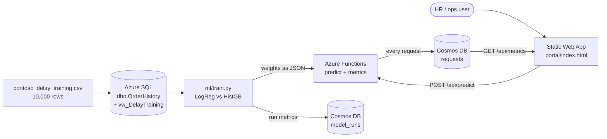

# Contoso Delay Classifier on Azure

**🌐 Live portal:** https://blue-river-0b185dd00.4.azurestaticapps.net

Predicts whether a Contoso order will be **delivered late**, end to end: Azure SQL → trained
classifier → Azure Functions API → Static Web App portal, with every request logged to Cosmos DB
and surfaced as live p50/p95 latency and error rate.

## Architecture



**Why the model ships as JSON weights.** The portal runs on Static Web Apps with a managed
Functions API. Shipping the fitted logistic model as `coef` + `intercept` + scaler parameters
(`api/model.json`) means scoring is `sigmoid(w·z + b)` in Node — no Python runtime, no container,
cold start in milliseconds. Node and scikit-learn agree to **0.0 absolute difference** on test
rows (`scripts/parity_check`).

## Area A — Azure SQL

`sql/01_schema.sql` creates `dbo.OrderHistory` (typed, with a `CHECK` on `order_hour`) plus
`dbo.vw_DelayTraining`, the view the model trains on, so features and analysis can't drift apart.
Three indexes back the three queries below. All **10,000 rows are loaded into Azure SQL** (training view: 10,000 rows) and the results below are the actual output of `sql/02_analysis_queries.sql` run against the database, reproduced by `scripts/load_sql.py`.

`sql/02_analysis_queries.sql` answers all three. Every query returns a **rate**, not a count —
counts would just rank by volume. Results on the 10,000 rows (overall delay rate **18.07%**):

**Q1 — delay rate by carrier**

| carrier | orders | delayed | delay rate |
|---|--:|--:|--:|
| IndiaPost | 1,563 | 447 | **28.60%** |
| EcomExp | 1,988 | 400 | 20.12% |
| Delhivery | 3,428 | 562 | 16.39% |
| BlueDart | 3,021 | 398 | **13.17%** |

> IndiaPost is **2.2× worse than BlueDart**. Carrier is the single strongest categorical signal.

**Q2 — delay rate by sale day**

| day type | orders | delayed | delay rate |
|---|--:|--:|--:|
| Sale day | 1,148 | 369 | **32.14%** |
| Normal day | 8,852 | 1,438 | 16.24% |

> A promotion day **almost exactly doubles** the delay rate (1.98× lift).

**Q3 — delay rate by warehouse backlog** (bucketed; raw values 14–65 would give dozens of tiny groups)

| backlog band | orders | delayed | delay rate |
|---|--:|--:|--:|
| Low (<35) | 1,949 | 296 | 15.19% |
| Medium (35–44) | 5,687 | 1,011 | 17.78% |
| High (45–54) | 2,226 | 463 | 20.80% |
| Critical (55+) | 138 | 37 | **26.81%** |

> Monotonic: backlog is a genuine risk gradient, not a threshold effect.

## Area B — the model

Trained on an 80/20 stratified split (`ml/train.py`). **Held-out test metrics (n = 2,000):**

| model | AUC | precision | recall | F1 | accuracy |
|---|--:|--:|--:|--:|--:|
| **LogisticRegression** (shipped) | **0.7425** | 0.3394 | **0.6731** | **0.4513** | 0.7045 |
| HistGradientBoosting | 0.7205 | 0.4841 | 0.1690 | 0.2505 | **0.8175** |

**Why the lower-accuracy model is the right one.** Only 18.07% of orders are delayed, so a model
that predicts "never late" scores **81.9% accuracy** while being operationally useless. That is
almost exactly what HistGradientBoosting does: it wins on accuracy (0.8175) but finds only
**17% of actual delays** (recall 0.169). The logistic model, fitted with `class_weight="balanced"`,
catches **67% of real delays** at the cost of more false alarms — the correct trade when a missed
delay means an angry customer and a false alarm means a cheap heads-up. This is precisely why the
brief asks for AUC/precision/recall/F1 rather than accuracy.

Confusion matrices (test set): LogReg `tn=1166 fp=473 fn=118 tp=243` · HistGB `tn=1574 fp=65 fn=300 tp=61`.

## Area C — Cosmos DB

| container | partition key | why |
|---|---|---|
| `requests` | `/date` (`YYYY-MM-DD`) | The dashboard only ever reads a recent slice, so date keeps "today's metrics" a **single-partition** query. The known trade-off is that all of today's writes land on one logical partition; at this volume that is far below the 10 GB / 10k RU logical-partition limit, and `/id` would spread writes perfectly but force every dashboard read cross-partition. |
| `model_runs` | `/model_name` | Tiny and read-mostly — one document per training run. Low cardinality is acceptable because the container will hold tens of documents, not millions, and every query filters by model. |

`scripts/seed_model_runs.js` writes the training metrics into `model_runs` after each run.

## Area D — portal + API

- `POST /api/predict` — validates every field (type, range, allowed carrier) and returns
  **400 with a per-field reason list** rather than throwing. Returns `Likely delayed` /
  `Likely on time`, the probability, threshold and server latency.
- `GET /api/metrics` — p50/p95/min/max latency, error rate, request count and the 10 most recent
  requests, read back out of Cosmos.
- `portal/index.html` — one page, no build step, light/dark aware, polls metrics every 10s.

## Verified live results

Measured against the deployed app (`scripts/loadtest.sh`):

| Check | Result |
|---|---|
| Load test — 120 requests, concurrency 12 | **120/120 HTTP 200** |
| Server-side latency (Cosmos-logged) | **p50 0.14 ms · p95 0.45 ms** |
| Failure test — malformed payload | **HTTP 400** with 8 per-field reasons, never a 500 |
| Error rate over the window | **0.82%** (the single deliberate 400) |
| Requests logged to Cosmos `requests` | **122** |
| `model_runs` documents | 2 (LogReg + HistGB, with AUC/F1/recall) |
| Scoring parity, Node vs scikit-learn | **0.0 absolute difference** |

Example live call:

```bash
curl -X POST https://blue-river-0b185dd00.4.azurestaticapps.net/api/predict \
  -H 'Content-Type: application/json' \
  -d '{"carrier":"IndiaPost","distance_km":1500,"weight_kg":4.2,"items":5,
       "order_hour":18,"is_sale_day":1,"warehouse_backlog":55,"weather_index":0.6}'
# {"label":"Likely delayed","probability":0.9599,"threshold":0.5,
#  "model":"contoso-delay-lr@1.0.0","latency_ms":1.35}
```

## Area E — observability

Every request is written to Cosmos (**including 400s**, so the error rate is honest) with
timestamp, status, latency, verdict and probability. Logging is wrapped so a Cosmos outage
degrades to "predictions still work, logging off" instead of a 500.
`scripts/loadtest.sh` runs a concurrent load test and a malformed-payload failure test.

## Security

- **No secrets in git.** Cosmos endpoint/key live in Static Web App application settings
  (server-side only) and are read via `process.env` inside the Functions API. The browser never
  sees them; `.env.local` is gitignored.
- Input is validated and range-checked before it reaches the model.
- Security headers (`nosniff`, `DENY`, `no-referrer`) set in `staticwebapp.config.json`.

## Run it

```bash
# 1. provision (idempotent)
SQL_PASS='<strong-password>' ./scripts/provision.sh

# 2. load data + create schema/view, then run the three analysis queries
#    (sql/01_schema.sql, load_part*.sql, sql/02_analysis_queries.sql)

# 3. train + export weights
python ml/train.py data/contoso_delay_training.csv

# 4. deploy portal + API
swa deploy ./portal --api-location ./api --deployment-token "$SWA_TOKEN" --env production

# 5. load + failure test
./scripts/loadtest.sh https://<your-host>
```

## Cleanup

The ML endpoint and SQL database bill while idle:

```bash
az group delete -n rg-contoso-delay --yes --no-wait
```
